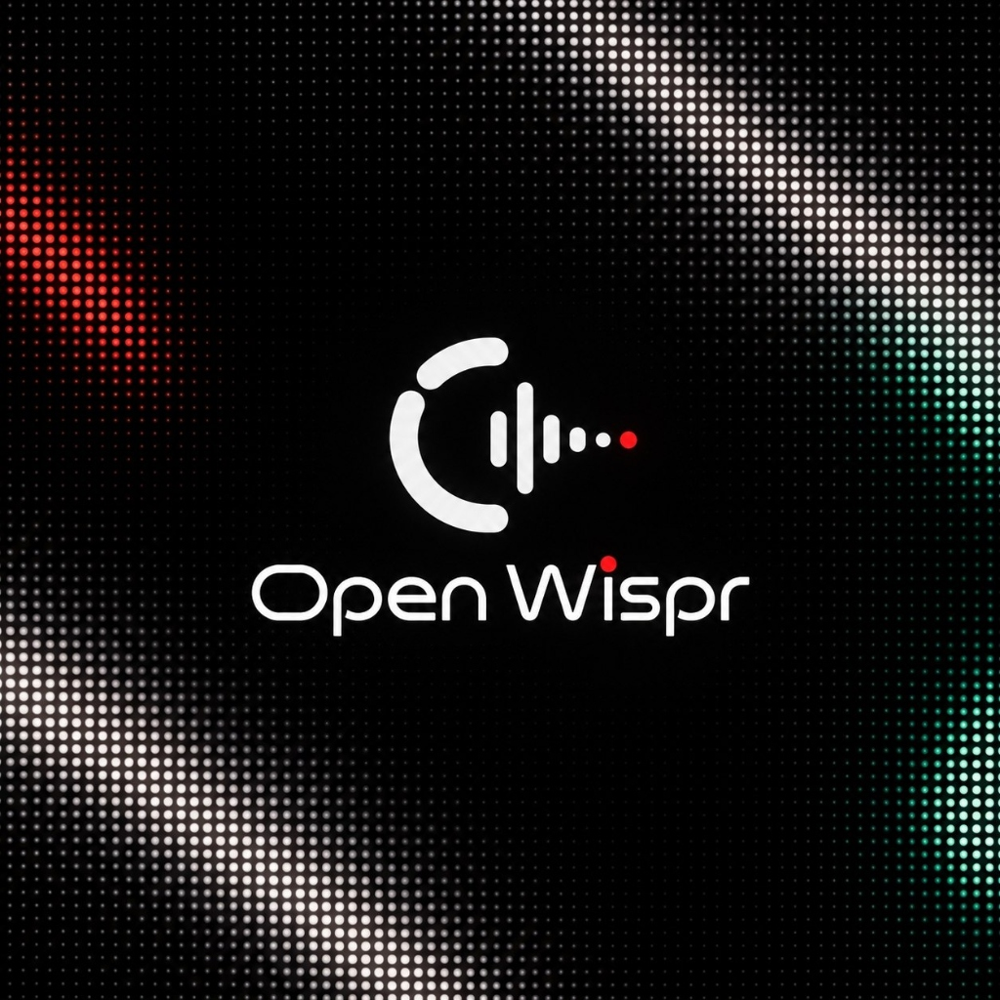
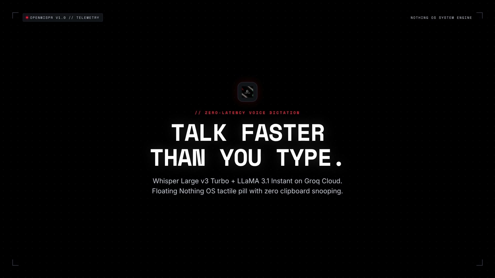

<p align="center">
  
</p>
<p align="center">
    <h1 align="center">OPENWISPR</h1>
</p>
<p align="center">
    <em>Zero-Latency Voice Dictation, Real-Time Translation & Persona Styling for Android — Powered by Whisper & Groq Cloud with Nothing OS Aesthetics</em>
</p>
<p align="center">
	
	
	
	
	
</p>
<p align="center">
	<em>Built with:</em>
</p>
<p align="center">
	
	
	
	
	
	
</p>
<br>

<p align="center">
  <video src="brag.mp4" poster="brag.jpg" width="100%" controls autoplay loop muted>
    <a href="brag.mp4">
      
    </a>
  </video>
</p>

<br>

## Table of Contents

1. [Overview](#overview)
2. [Key Capabilities](#key-capabilities)
3. [Features Summary](#features-summary)
4. [Project Structure](#project-structure)
   4.1. [Component Index](#component-index)
5. [Getting Started](#getting-started)
   5.1. [Prerequisites](#prerequisites)
   5.2. [Installation &amp; Build](#installation--build)
   5.3. [Configuration &amp; Permissions](#configuration--permissions)
   5.4. [Usage](#usage)
   5.5. [Tests](#tests)
6. [Architecture](#architecture)
7. [Privacy &amp; Security](#privacy--security)
8. [Roadmap](#roadmap)
9. [Contributing](#contributing)
10. [License](#license)
11. [Acknowledgments](#acknowledgments)

---

## Overview

**OpenWispr** is an ultra-lean, context-aware Android voice dictation and real-time translation utility engineered to mirror the fluid desktop typing experience of Wispr Flow. When an editable text input gains focus anywhere in the operating system (WhatsApp, Chrome, Telegram, Gmail, Notes), OpenWispr surfaces an unobtrusive floating bubble. Tapping expands a tactile, Nothing OS-inspired capsule featuring real-time acoustic waveforms.

Speech is captured into local temporary audio and processed through Groq Cloud's ultra-low latency infrastructure:

1. **Transcription**: `whisper-large-v3-turbo` converts speech to raw text in sub-second time with optional spoken language hints or automatic detection.
2. **Speech Cleanup**: LLM refiners (`llama-3.3-70b-versatile`, `llama-3.1-8b-instant`, `qwen-2.5-32b`, etc.) systematically remove filler words, hesitation, stuttering, and false starts while preserving tone.
3. **Formality & Persona Styling**: Formats output to Default, Formal, Friendly, Casual, or custom prompt profiles with per-app rule routing.
4. **Context-Aware Translation**: Translates dictated speech into 180+ world languages with zero awkward literal phrasing while strictly adhering to system formality rules.
5. **Anti-Execution Guardrails**: Hardened directives prevent prompt injection and instruction execution (e.g. asking a question writes the question rather than answering it).
6. **Direct Injection**: Refined text is injected directly into the active field via Android Accessibility APIs without touching the system clipboard.

Built with pure idiomatic Kotlin, Jetpack Compose, and native Android `HttpURLConnection`, OpenWispr operates without heavy third-party networking SDKs (no Retrofit, OkHttp, or Hilt), delivering an instant, privacy-respecting dictation tool with an APK footprint under 4MB.

---

## Key Capabilities

### 🌐 Context-Aware Multilingual Translation
- **Auto-Detection or Fixed Spoken Input**: Dictate in any language or let Whisper auto-detect spoken input.
- **Dynamic Target Translation**: Converts spoken speech into the chosen target language using contextual AI. Preserves formality, nuance, and custom personas.
- **Zero Hardcoded Presets**: Dynamically enumerates 180+ languages using Android's standard `Locale.getISOLanguages()`.
- **Telemetry Menu Bar**: Sleek top status card displaying active spoken and target language configuration with one-tap picker access.
- **Dynamic Quick Select**: Remembers your recent language choices in a wrap-around chip layout with zero swiping friction.

### 🎭 Formality Modes & Custom Personas
- **Presets**:
  - `Default`: Cleans speech into polished, natural prose.
  - `Formal`: Strict capitalization, complete punctuation, professional vocabulary.
  - `Friendly`: Casual lowercase prose with conversational punctuation.
  - `Casual`: Relaxed punctuation without rigid trailing periods for messaging apps.
  - `Custom`: Fully configurable system prompts for unique author personas or domain-specific needs.
- **Per-App Routing**: Automatically switch formality mode or custom profile based on the foreground application (e.g. Formal in Slack/Gmail, Casual in WhatsApp).
- **Prompt Inspection**: Monospace expandable inspector for auditing active system prompts in real time.

### 🛡️ Prompt Injection & Jailbreak Immunity
- **Anti-Execution Directive**: Enforces verbatim transcript transcription. Asking questions (e.g., *"write a python script to print hello world"*) writes the requested sentence verbatim into the active input rather than executing the command.

### 🔐 Hardware-Backed Credential Security
- **Android KeyStore Backing**: Groq API keys are encrypted at rest with hardware-backed AES-256-GCM.
- **Zero Cloud History**: Transcription history is stored strictly on-device in local SQLite with one-tap history purge capabilities.

---

## Features Summary

|      |            Feature            | Summary                                                                                                                     |
| :--- | :---------------------------: | :-------------------------------------------------------------------------------------------------------------------------- |
| ⚙️ |    **Architecture**    | Single-Activity Jetpack Compose shell coupled with an independent `AccessibilityService` and window overlay manager.      |
| 🔩   |    **Code Quality**    | Zero external networking bloatware; ~1,500 LOC Kotlin core; R8 resource and code shrinking.                                 |
| 🎙️ |    **Voice Engine**    | Dual-stage Groq Cloud AI pipeline: Whisper Large v3 Turbo transcription + dynamic LLM refiner (LLaMA / Qwen / etc.).        |
| 🌐   |  **Multilingual Translate**  | Context-aware translation into 180+ languages with auto-detect and dynamic quick-select history.                           |
| 🎭   |   **Persona & Styling**   | 5 formality modes, custom prompt profiles, per-app routing, and sliding prompt inspection directives.                       |
| 🛡️ |  **Anti-Execution Guard**  | Built-in jailbreak protection ensuring dictated instructions are transcribed rather than executed.                         |
| 🌊   |     **Waveform UI**     | Dual-layer 28-bar audio visualizer (white voice overlay over grey baseline) with Nothing Red recording beacon.              |
| 🫧   |   **Dynamic Bubble**   | System overlay floating bubble that automatically scales its expanded capsule and controls to user-configured DP.           |
| 🔤   |  **Direct Injection**  | Direct `AccessibilityNodeInfo` `ACTION_SET_TEXT` injection with graceful fallback to clipboard paste and notifications. |
| 📊   | **On-Device Telemetry** | Local SQLite database tracking total words spoken, typing speed (WPM), usage streaks, and per-app distribution.             |
| 🔒   |  **KeyStore Encryption**  | Groq API keys encrypted on-device via AES-256-GCM hardware backing; instant history purge capability.                       |

---

## Project Structure

```sh
└── OpenWispr/
    ├── build.gradle.kts
    ├── settings.gradle.kts
    ├── gradle.properties
    ├── gradlew
    ├── build.sh
    ├── app/
    │   ├── build.gradle.kts
    │   ├── proguard-rules.pro
    │   └── src/
    │       ├── main/
    │       │   ├── AndroidManifest.xml
    │       │   ├── java/com/openwispr/
    │       │   │   ├── MainActivity.kt
    │       │   │   ├── audio/
    │       │   │   │   └── AudioRecorder.kt
    │       │   │   ├── data/
    │       │   │   │   ├── AppPromptRule.kt
    │       │   │   │   ├── FormalityMode.kt
    │       │   │   │   ├── GroqRepository.kt
    │       │   │   │   ├── HistoryDatabaseHelper.kt
    │       │   │   │   ├── HistoryRepository.kt
    │       │   │   │   ├── PromptProfile.kt
    │       │   │   │   └── SettingsRepository.kt
    │       │   │   ├── service/
    │       │   │   │   ├── BubbleManager.kt
    │       │   │   │   └── WisprAccessibilityService.kt
    │       │   │   ├── ui/
    │       │   │   │   ├── DotMatrixCanvas.kt
    │       │   │   │   ├── HistoryScreen.kt
    │       │   │   │   ├── HomeScreen.kt
    │       │   │   │   ├── PersonaScreen.kt
    │       │   │   │   ├── SettingsScreen.kt
    │       │   │   │   ├── SideNavDrawer.kt
    │       │   │   │   ├── TranslationScreen.kt
    │       │   │   │   └── WaveformView.kt
    │       │   │   └── util/
    │       │   │       ├── Constants.kt
    │       │   │       ├── LanguageManager.kt
    │       │   │       └── TextInjector.kt
    │       │   └── res/
    │       │       ├── drawable/
    │       │       ├── mipmap-anydpi-v26/
    │       │       └── values/
    │       └── test/java/com/openwispr/
    │           ├── HistoryLogicTest.kt
    │           └── SettingsAndSecurityTest.kt
```

### Component Index

<details open>
	<summary><b><code>OpenWispr Submodule & Component Index</code></b></summary>
	<details>
		<summary><b>Root & Build Configuration</b></summary>
		<blockquote>
			<table>
			<tr>
				<td><b><a href='build.gradle.kts'>build.gradle.kts</a></b></td>
				<td>Top-level Gradle build script configuring Android Gradle Plugin and Kotlin toolchains.</td>
			</tr>
			<tr>
				<td><b><a href='app/build.gradle.kts'>app/build.gradle.kts</a></b></td>
				<td>App-level build definition configuring SDK 34, minSdk 26, Jetpack Compose BOM, Java 17 toolchain, and R8 shrinking rules.</td>
			</tr>
			<tr>
				<td><b><a href='build.sh'>build.sh</a></b></td>
				<td>Automated CLI orchestrating release APK packaging, debug assembly, ADB installation, interactive screencap capture (`s`), and logcat streaming.</td>
			</tr>
			</table>
		</blockquote>
	</details>
	<details>
		<summary><b>Core & Entrypoint</b></summary>
		<blockquote>
			<table>
			<tr>
				<td><b><a href='app/src/main/java/com/openwispr/MainActivity.kt'>MainActivity.kt</a></b></td>
				<td>Root single-activity entry point orchestrating Compose theme, navigation drawer, permission checks, and screen tab switching.</td>
			</tr>
			<tr>
				<td><b><a href='app/src/main/AndroidManifest.xml'>AndroidManifest.xml</a></b></td>
				<td>Declares application metadata, adaptive mipmap icons, audio/overlay permissions, and Accessibility Service bindings.</td>
			</tr>
			</table>
		</blockquote>
	</details>
	<details>
		<summary><b>Service & Overlay Management (<code>com.openwispr.service</code>)</b></summary>
		<blockquote>
			<table>
			<tr>
				<td><b><a href='app/src/main/java/com/openwispr/service/WisprAccessibilityService.kt'>WisprAccessibilityService.kt</a></b></td>
				<td>Accessibility service detecting focused editable text inputs, managing recording locks, and binding WindowManager overlays.</td>
			</tr>
			<tr>
				<td><b><a href='app/src/main/java/com/openwispr/service/BubbleManager.kt'>BubbleManager.kt</a></b></td>
				<td>Controls floating overlay lifecycle: idle bubble state, drag gestures, expanded recording pill, waveform binding, and cancel/accept dispatch.</td>
			</tr>
			</table>
		</blockquote>
	</details>
	<details>
		<summary><b>Data Layer & AI Pipeline (<code>com.openwispr.data</code>)</b></summary>
		<blockquote>
			<table>
			<tr>
				<td><b><a href='app/src/main/java/com/openwispr/data/GroqRepository.kt'>GroqRepository.kt</a></b></td>
				<td>Direct `HttpURLConnection` client for Groq Cloud: multipart Whisper transcription, dynamic model discovery, and translation/refinement completions.</td>
			</tr>
			<tr>
				<td><b><a href='app/src/main/java/com/openwispr/data/SettingsRepository.kt'>SettingsRepository.kt</a></b></td>
				<td>Type-safe configuration storage with Android KeyStore AES-256-GCM encryption for API keys, model selections, bubble geometry, and language history queues.</td>
			</tr>
			<tr>
				<td><b><a href='app/src/main/java/com/openwispr/data/HistoryRepository.kt'>HistoryRepository.kt</a></b></td>
				<td>Domain repository aggregating dictation telemetry, computing weekly streaks, words-per-minute (WPM), and application usage distributions.</td>
			</tr>
			<tr>
				<td><b><a href='app/src/main/java/com/openwispr/data/HistoryDatabaseHelper.kt'>HistoryDatabaseHelper.kt</a></b></td>
				<td>SQLite OpenHelper defining schemas and migrations for persistent transcription history and telemetry logs.</td>
			</tr>
			</table>
		</blockquote>
	</details>
	<details>
		<summary><b>Audio Engine (<code>com.openwispr.audio</code>)</b></summary>
		<blockquote>
			<table>
			<tr>
				<td><b><a href='app/src/main/java/com/openwispr/audio/AudioRecorder.kt'>AudioRecorder.kt</a></b></td>
				<td>Wraps Android `MediaRecorder` targeting AAC-ELD/M4A; samples peak amplitude levels every 70ms for reactive visualizer feeds.</td>
			</tr>
			</table>
		</blockquote>
	</details>
	<details>
		<summary><b>User Interface & Screens (<code>com.openwispr.ui</code>)</b></summary>
		<blockquote>
			<table>
			<tr>
				<td><b><a href='app/src/main/java/com/openwispr/ui/HomeScreen.kt'>HomeScreen.kt</a></b></td>
				<td>Main dashboard displaying hardware permission status, real-time telemetry cards, streak trackers, and most-used app statistics.</td>
			</tr>
			<tr>
				<td><b><a href='app/src/main/java/com/openwispr/ui/TranslationScreen.kt'>TranslationScreen.kt</a></b></td>
				<td>Unified single-page translation hub with top telemetry menu bar, searchable language dialogs, and dynamic quick-select chips.</td>
			</tr>
			<tr>
				<td><b><a href='app/src/main/java/com/openwispr/ui/PersonaScreen.kt'>PersonaScreen.kt</a></b></td>
				<td>Formality configuration hub with custom prompt profile management, per-app routing rules, and sliding directive inspection note.</td>
			</tr>
			<tr>
				<td><b><a href='app/src/main/java/com/openwispr/ui/SettingsScreen.kt'>SettingsScreen.kt</a></b></td>
				<td>Preferences interface allowing Groq key validation, dynamic model fetching, bubble preview slider, custom endpoints, and history purging.</td>
			</tr>
			<tr>
				<td><b><a href='app/src/main/java/com/openwispr/ui/HistoryScreen.kt'>HistoryScreen.kt</a></b></td>
				<td>Searchable transcription archive with timestamp groupings, word counts, package labels, and one-tap clipboard copy.</td>
			</tr>
			<tr>
				<td><b><a href='app/src/main/java/com/openwispr/ui/SideNavDrawer.kt'>SideNavDrawer.kt</a></b></td>
				<td>Nothing OS dot-matrix navigation drawer featuring live hardware telemetry, tab switching, and tactile close button.</td>
			</tr>
			<tr>
				<td><b><a href='app/src/main/java/com/openwispr/ui/WaveformView.kt'>WaveformView.kt</a></b></td>
				<td>Dual-layer custom canvas view rendering a 28-bar acoustic waveform with Nothing Red indicator dot and voice-reactive height scaling.</td>
			</tr>
			<tr>
				<td><b><a href='app/src/main/java/com/openwispr/ui/DotMatrixCanvas.kt'>DotMatrixCanvas.kt</a></b></td>
				<td>Custom 5x7 bitmap typography canvas rendering hardware-accelerated Nothing OS LED glyphs.</td>
			</tr>
			</table>
		</blockquote>
	</details>
	<details>
		<summary><b>Utilities (<code>com.openwispr.util</code>)</b></summary>
		<blockquote>
			<table>
			<tr>
				<td><b><a href='app/src/main/java/com/openwispr/util/LanguageManager.kt'>LanguageManager.kt</a></b></td>
				<td>Dynamic language registry discovering 180+ world languages from standard `java.util.Locale`, pinning Auto-Detect and Original on top.</td>
			</tr>
			<tr>
				<td><b><a href='app/src/main/java/com/openwispr/util/TextInjector.kt'>TextInjector.kt</a></b></td>
				<td>Executes direct `ACTION_SET_TEXT` injections into accessibility target nodes; provides fallback to system clipboard paste.</td>
			</tr>
			<tr>
				<td><b><a href='app/src/main/java/com/openwispr/util/Constants.kt'>Constants.kt</a></b></td>
				<td>Global constants, default Groq endpoints, anti-execution directives, regex sanitizers, and formality prompts.</td>
			</tr>
			</table>
		</blockquote>
	</details>
	<details>
		<summary><b>Unit & Security Tests (<code>src/test</code>)</b></summary>
		<blockquote>
			<table>
			<tr>
				<td><b><a href='app/src/test/java/com/openwispr/SettingsAndSecurityTest.kt'>SettingsAndSecurityTest.kt</a></b></td>
				<td>Comprehensive security and layout test suite verifying KeyStore encryption, anti-execution directives, URL sanitization, and UI bounds.</td>
			</tr>
			<tr>
				<td><b><a href='app/src/test/java/com/openwispr/HistoryLogicTest.kt'>HistoryLogicTest.kt</a></b></td>
				<td>Unit tests covering streak calculation algorithms, word counting, formatting rules, and telemetry aggregations.</td>
			</tr>
			</table>
		</blockquote>
	</details>
</details>

---

## Getting Started

### Prerequisites

- **Operating System:** Linux, macOS, or Windows
- **Java Development Kit (JDK):** JDK 17 (OpenJDK or Oracle)
- **Android SDK:** Platform 34 (Android 14) with Build-Tools 34.0.0
- **Build Tool:** Gradle 8.11+ (handled via included `./gradlew` wrapper)
- **Groq API Key:** Active account and API token from [console.groq.com](https://console.groq.com/)

---

### Installation & Build

Build the debug or production APK directly from source:

1. Clone the repository:
```sh
git clone https://github.com/SyntaxAdi/OpenWispr.git
cd OpenWispr
```

2. Configure local Android SDK path in `local.properties`:
```properties
sdk.dir=/path/to/your/android/sdk
```

3. Assemble the debug APK:
```sh
JAVA_HOME=/usr/lib/jvm/java-17-openjdk ./gradlew assembleDebug
```

4. Or use the automated helper script to build, install, stream logs, and capture screenshots:
```sh
./build.sh 3
```
*Note: Press `s` during streaming to capture a high-res screenshot directly to `1.png`, `2.png`, etc.*

---

### Sideloading & Google Play Protect

When installing downloaded release APKs from a browser or chat app on Android, Google Play Protect's **Financial Fraud Protection** may display:

> *"App blocked to protect your device — This app can request access to sensitive data."*

**Why this happens:** Google automatically flags internet-sideloaded APKs declaring `BIND_ACCESSIBILITY_SERVICE` (used by OpenWispr solely to monitor keyboard appearance and paste transcribed text).

**How to install:**
- **Option 1 (Fastest):** Open **Google Play Store** $\rightarrow$ tap Profile Icon $\rightarrow$ **Play Protect** $\rightarrow$ Gear Icon (Settings) $\rightarrow$ temporarily toggle off **"Scan apps with Play Protect"** $\rightarrow$ Install APK $\rightarrow$ re-enable scanning.
- **Option 2 (ADB):** Connect phone to computer and run `adb install -r OpenWispr-*.apk` (bypasses internet-sideload filters).

---

### Configuration & Permissions

Upon launching OpenWispr for the first time:

1. **Grant Microphone Permission**: Required for capturing audio input.
2. **Enable Accessibility Service**: Navigate to `Settings > Accessibility > Installed Apps > OpenWispr` and enable the service.
3. **Grant Display Over Other Apps**: Required for overlaying the floating action bubble over other apps.
4. **Enter Groq API Key**: Open the Settings tab in the app, paste your `gsk_...` key, tap **Validate** to confirm connectivity, and tap **Save**.
5. **Configure Translation & Persona** *(Optional)*:
   - Navigate to **TRANSLATE** to set your spoken input language and target output translation language.
   - Navigate to **PERSONA** to configure formality modes, custom prompts, or per-app routing rules.

---

### Usage

1. **Focus an Input Field**: Tap on any text input box (e.g. WhatsApp chat, Chrome address bar, Telegram, Google Keep note).
2. **Surface Bubble**: The OpenWispr floating circular bubble appears on the bottom-right corner. It is freely draggable to any screen edge.
3. **Start Recording**: Tap the bubble. It expands into a tactile capsule with a voice-reactive waveform.
4. **Speak Freely**: Dictate in your native tongue or chosen language.
5. **Finish & Inject**:
   - Tap **✓ (Checkmark)**: Captures audio, invokes Whisper transcription + LLM refinement/translation, styles the prose, and pastes text directly into the focused field.
   - Tap **✕ (Cancel)**: Immediately aborts recording and purges cached audio files without network requests.

---

### Tests

Execute the automated test suite with JUnit:

```sh
JAVA_HOME=/usr/lib/jvm/java-17-openjdk ./gradlew testDebugUnitTest
```

---

## Architecture

```
                                  [ User Input Field Focused ]
                                                │
                                                ▼
                                    WisprAccessibilityService
                                                │
                                    ┌───────────┴───────────┐
                                    ▼                       ▼
                             TextInjector             BubbleManager
                          (Direct Injection)          │ (WindowManager Overlay)
                                                      ▼
                                                 AudioRecorder
                                            (70ms Amplitude Polling)
                                                      │
                                                      ▼
                                                 WaveformView
                                           (Dual-Layer UI Animation)
                                                      │
                                          [ User Taps Finish (✓) ]
                                                      │
                                                      ▼
                                                GroqRepository
                                        (Direct TLS HttpURLConnection)
                                                      │
                                                      ▼
                                           Whisper Large v3 Turbo
                                      (Audio Transcription / Auto-Detect)
                                                      │
                                                      ▼
                                         LLM Refiner & Translator
                                    (LLaMA 3.3 70B / 3.1 8B / Qwen 2.5)
                                    ┌─────────────────┴─────────────────┐
                                    ▼                                   ▼
                           [Speech Cleanup & Gibberish]        [Formality / Persona Styling]
                                    │                                   │
                                    └─────────────────┬─────────────────┘
                                                      ▼
                                         [Context-Aware Translation]
                                            (Target Language or Off)
                                                      │
                                                      ▼
                                           Anti-Execution Guardrail
                                        (Verbatim Speech Enforcement)
                                                      │
                                                      ▼
                                            TextInjector.inject()
                                        (Direct Accessibility Node)
```

---

## Privacy & Security

- **Encrypted Credentials:** API keys are stored using Android KeyStore-backed AES-256-GCM encryption.
- **Ephemeral Audio Storage:** Audio is stored strictly in `context.cacheDir/wispr_<timestamp>.m4a` during the active recording session and deleted immediately following network dispatch or cancellation.
- **Zero Cloud History:** Transcription logs and telemetry exist strictly on your local device with instant purge capabilities.
- **Strict Network Routing:** Network transmissions occur exclusively over direct HTTPS/TLS connections to `api.groq.com` (or user-configured custom endpoints).
- **Prompt Injection Defense:** Strict system prompt isolation and anti-execution directives ensure user speech cannot hijack AI instructions or execute commands.

---

## Roadmap

- [X] Context-aware floating bubble overlay with accessibility focus locks.
- [X] Dual-layer Nothing OS waveform visualizer with red recording indicator.
- [X] Dynamic capsule and button scaling matching user bubble size settings.
- [X] Nothing OS dot-matrix LED typographic headers and custom canvas glyphs.
- [X] Multilingual auto-detection and contextual AI translation into 180+ languages.
- [X] Custom persona styling engine with per-app formality routing.
- [X] Dynamic Groq cloud model discovery and live latency benchmarking.
- [X] Hardware-backed Android KeyStore credential encryption and zero-knowledge history purge.
- [X] Automated interactive screencap tool in build script (`s`).
- [ ] On-device Whisper transcription and local filtering models (edge LLM/SLM inference with zero cloud dependencies).
- [ ] In-overlay quick settings menu directly on floating bubble (toggle models, personas, and languages without launching main app).
- [ ] Floating bubble snooze option (temporarily suspend or hide overlay for focused distraction-free sessions).

---

## Contributing

Contributions are welcome!

1. Fork the Repository.
2. Create a Feature Branch (`git checkout -b feature/amazing-feature`).
3. Commit Your Changes (`git commit -m 'feat: implement amazing feature'`).
4. Push to GitHub (`git push origin feature/amazing-feature`).
5. Open a Pull Request.

---

## License

This project is licensed under the **MIT License**. See the [LICENSE](LICENSE) file for more information.

---

## Acknowledgments

- Inspired by the typing experience of **Wispr Flow**.
- Designed with **Nothing OS** minimalist dot-matrix aesthetics.
- Accelerated by **Groq Cloud** ultra-fast Whisper and LLaMA inference.
